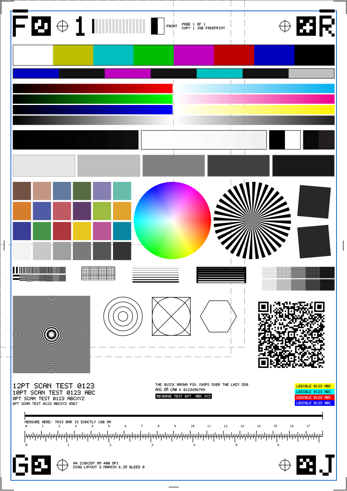

# The print test page and the received-document analyzer

Two pieces, both pure Python (Pillow + pypdfium2 + fakescan at call time; nothing here ships a page):

* `fakeprint.testpage` - parameters, a size-parametric layout adapter, and a deterministic vector PDF / PNG writer.
* `fakeprint.testpage_analyze` - given the document a printer RECEIVED, report what happened to the page on the way.



*(rendered by `render_pdf(PageParams(paper="a4")).png(100)`; documentation only, no test reads this file.)*

## Design rules

1. **No fixtures.** The page (PDF or PNG), its layout JSON and its QR payload are produced from `PageParams`: paper name or custom
   `WxH` mm, orientation, printable-area margin, bleed, dpi, colour / mono, page / pages, copy / copies, front / back, job tag. The same
   parameters give the same bytes (no dates, fixed `/ID`, Flate level 6). The sheet names known: A0-A6, ISO B3-B6, JIS B4-B6, Letter,
   Legal, Tabloid, Executive, Statement, any `210x297`.
2. **One layout engine, and it is fakescan's.** What is on the page and where (millimetres, scaled to the sheet, elements that do not fit
   marked `drawn: false` / `scale`) comes from the fakescan generator, together with the ground truth the analyzer checks. fakeprint-python
   owns only the PDF writer (`PdfWriter`, draws the layout's vector primitives by their mm coordinates at ANY sheet size) and the analyzer.
   `testpage.layout_for(params)` is the single adapter:

   * **expected from fakescan** (not landed when this was written): `fakescan.diag.page_layout(params: dict) -> dict` with
     `{"schema", "layout_version", "sheet_mm": [w, h], "elements": [{"id", "kind", "drawn", "rect_mm", "expected": {...}, "primitives": [...]}],
     "qr_payload"}`; the primitive schema (`line rect poly circle text image qr`, sheet-relative mm, y down) is in the `fakeprint.testpage`
     docstring. When this function exists it is used unchanged. (fakescan's work in progress spells it `diag_page_layout(dpi, version=3,
     **params)` + `diag_page_primitives(layout)` with its own op names and raster-only ops; whichever name ships, translating it to this
     primitive schema is the one job of `layout_for`.)
   * **fallback, clearly marked** (`layout["source"] == "fakescan.diag v2 fallback"`): the installed layout v2 (`diag_page_layout`): a fixed
     209.3 x 290.6 mm raster, no primitives, so the writer embeds its rendering at the sheet's top-left corner at its own physical size.
     Portrait only (`LayoutUnavailable` for landscape); on Letter it is clipped by the sheet (`layout["fallback"]["clipped_mm"]` says
     by how much and the analyzer reports exactly that).

3. **The writer is tested without any layout of ours**: `tests/test_testpage.py` feeds it a six-primitive double at A4, Letter, A5, A3,
   Legal, 123 x 456 mm and A4 / Letter landscape and samples the rendered pixels at the mm positions.

## What is on the page, and why

"v2 today" is what the fallback draws now; "parametric" is what the owner's list needs from fakescan's parametric layout (the analyzer
already looks for it by element kind; nothing else changes).

| Element | Why it is there | Status |
|---|---|---|
| page border (1 px hairline at the sheet edge) | which edge survived; a printer that cannot print to the edge shows a gap | v2 (at its raster edge) |
| printable-area frame (known inset) | measures the margin actually printed; a missing side = clipped | v2 (3 mm / top 12.5 mm), parametric (`margin_mm`) |
| corner crop marks + registration crosses | position and scale to ~0.03 % over 190 mm, skew; the analyzer's fit | v2 (4 crosses + ticks) |
| asymmetric glyph per corner (F R L P; back set G J Q 2) | rotation AND mirroring are obvious to a human and unambiguous to a program (the glyph is not symmetric under any of the 8 dihedral moves) | parametric |
| duplex back-side variant ('BACK', different markers) | page 2 of a two-sided job must come out upright relative to page 1 | parametric |
| `PAGE n OF N   COPY c OF C` stamp | collate and copy semantics visible on paper | parametric |
| QR carrying job tag / page / copy / media / the parameters | machine decode; a decoder can regenerate the expected page | v2 QR (fixed text), parametric (parameters) |
| dashed A4 and Letter outlines, labelled | what fits on which sheet | v2 (drawn only when it fits its raster), parametric |
| metric + inch rulers, a 100 mm and a 4 in bar | scale by eye, and a long baseline for the analyzer | v2 |
| line-weight ladder | thinnest line the path keeps | parametric |
| line-pair patches, slanted-edge squares, Siemens star | resolution and sharpness | v2 |
| hue wheel, R/G/B/neutral ramps, 16-step grey wedge, near-black / near-white steps and clip patches, colour patches | colour fidelity, mono conversion, clipping of shadows / highlights | v2 |
| text 6-12 pt, pangram, Unicode block | legibility, font substitution | v2 (6-12 pt); pangram and Latin-1/WinAnsi block parametric (standard fonts carry nothing beyond WinAnsi) |
| flat-field uniformity strips | banding, streaks, mottling | parametric |

## `fakeprint.testpage`

```python
from fakeprint import testpage as tp

params = tp.PageParams(paper="a4", orientation="portrait", pages=2, copies=2, job="smoke")
page = tp.render_pdf(params)          # TestPage: .pdf bytes, .layout dict, .meta, .png(dpi)
open("page.pdf", "wb").write(page.pdf)
open("page.png", "wb").write(page.png(150))   # pdfium raster, PNG carries the dpi

doc = tp.render_document(params, expand_copies=True, collate=True, duplex=True)   # p1c1 p2c1 p1c2 p2c2, front/back alternating
```

* `PageParams` is frozen, JSON-able (`to_dict` / `from_dict` / `replace`) and validates; `paper_size("ISO B5")`, `size_mm()`.
* Copies: by default the document carries ONE copy stamped `COPY 1 OF C` and the printer makes the others (what a `copies=C` job means);
  `expand_copies=True` makes the document carry them itself (`collate` p1 p2 p1 p2, else p1 p1 p2 p2). `duplex=True` stamps sides 1, 3, 5
  front and 2, 4, 6 back. The PDF `/Subject` records the parameters and the `[page, copy, side]` sequence so the analyzer knows what to
  expect for every page of a document that came through a client unchanged.
* No daemon endpoint. The daemon is Rust and has no PDF rasteriser or layout engine; serving a page there would mean a second layout engine
  or a stored fixture, both ruled out. A `GET /v1/testpage` can be added when fakescan's generator exists as a Rust function the daemon can
  call (it is the same crate family); until then the generator is this Python module.

## `fakeprint.testpage_analyze`

```python
from fakeprint import testpage_analyze as ta

rep = ta.analyze_document(received_bytes, "application/pdf", params)   # params optional for a PDF made by render_pdf
ta.brief(rep)                                   # the one-screen summary
rep = ta.analyze_document(data, fmt, params, pages="all")   # every page; rep["pages"] lists page / copy / side per page, in order
rep = ta.analyze_raster(ta.Raster(img, dpi_x, dpi_y, None, "image/pwg-raster"), params)   # any raster you decoded yourself
```

Pipeline: rasterise at an exact dpi (pdfium, 4x oversample box-reduced, the sub-pixel sliver cropped; PNG / JPEG / TIFF at their density)
-> regenerate the expected page from the parameters -> pick which of the 8 dihedral moves explains the received page (stretched and
physical-top-left alignments, whichever matches; `ambiguous` flag when two are close) -> undo it -> run `fakescan.diag.analyze_diag_page`
(fit of the registration crosses, per-element measurements) on the canonical raster -> margins, clipping, QR.

What it reports (`rep["summary"]` unless noted):

| Field | Meaning |
|---|---|
| `is_test_page`, `reason` | false with the reason for foreign documents ("not a fakeprint test page ...") or unreadable ones |
| `document` | pages, per-page MediaBox / CropBox / TrimBox / BleedBox / ArtBox in mm, which box defines the sheet (`effective_box`), `/Rotate`, embedded images (pixels, effective dpi, filters) |
| `verdict_orientation`, `rotation_deg_90s`, `mirrored` | "upright" / "rotated 180 degrees" / "mirrored left-right" / ... (what the path did to the page) |
| `scale_x`, `scale_y`, `skew_rotation_deg` | physical scale per axis (1.0 = right) from the crosses' 190 mm baseline; fine rotation |
| `sheet_mm`, `sheet_size_ok`, `expected_sheet_mm` | received sheet vs the parameters |
| `margins_mm` | where the layout box landed on the sheet (left, top, right, bottom; negative = outside) |
| `clipped_edges`, `layout_beyond_sheet_mm` | frame sides that did not survive, and layout that lies outside the sheet |
| `qr_text`, `qr_ok`, `page`, `pages`, `copy`, `copies`, `side`, `job` | the QR decoded by `fakeprint.qrdecode` (versions 1-10, RS syndromes checked) and its fields |
| `hue_err_deg_max_abs`, `shadows_clipped_steps`, `highlights_clipped_steps`, `res_lines_*_last_resolvable_period_mm`, ... | colour / ramp / resolution results; the whole per-element report is `rep["elements"]` with `detail="full"` |
| `fit` = `"failed"` | fewer than 3 of the 4 registration crosses found (corners cut off) or a poor fit: orientation only, no measurements |

Limits, stated: the resolution figures are limited by the analysis dpi (150 by default; raise `dpi`), a printer's halftoning and a scan's
noise are not modelled (it reads documents, not paper), the QR decoder does not correct errors, and it is pure Python (about 1.5 s a page,
`detail="fast"` skips the per-element report).

### From a job

```python
c = srv.client()                       # or fakeprint.Client(base_url)
c.job_analysis(job_id)["summary"]      # lazy, Python-side: reads the stored document from the job row's path
c.job(job_id, analysis=True).analysis  # the same summary on the Job row
```

The daemon (Rust) shows job rows only; it computes nothing about the received page and has no thumbnail (there is no PDF rasteriser in
the daemon; a thumbnail would need one). `job_analysis` needs read access to the stored file (embedded `Server` or a daemon on the same
machine).

## Tests

`tests/test_testpage.py` (no fixtures): paper registry, the writer at eight sheet shapes, determinism, mono, PNG dpi, the adapter's
fallback limits, the QR decoder (against fakescan's own QR, which also validates the tables: syndromes are zero), the analyzer against
defects injected into a generated page (rotations, mirrors, 0.94 scale, cropped edge, cut corners, foreign documents, multi-page) and
`Client.job_analysis` through the embedded server. The cross-client run is in `pdfcraft-fakeprint` (section k).
